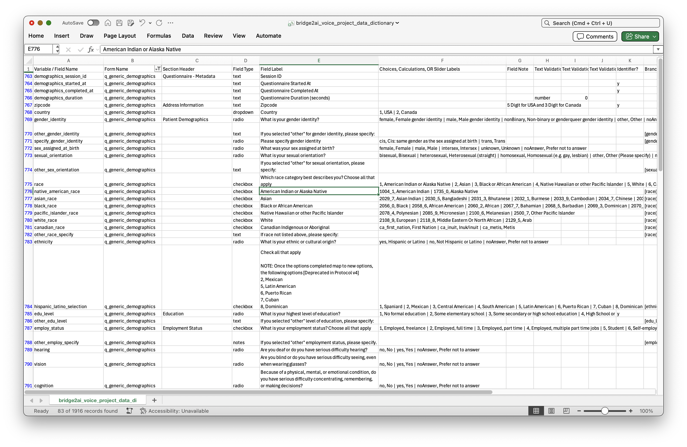
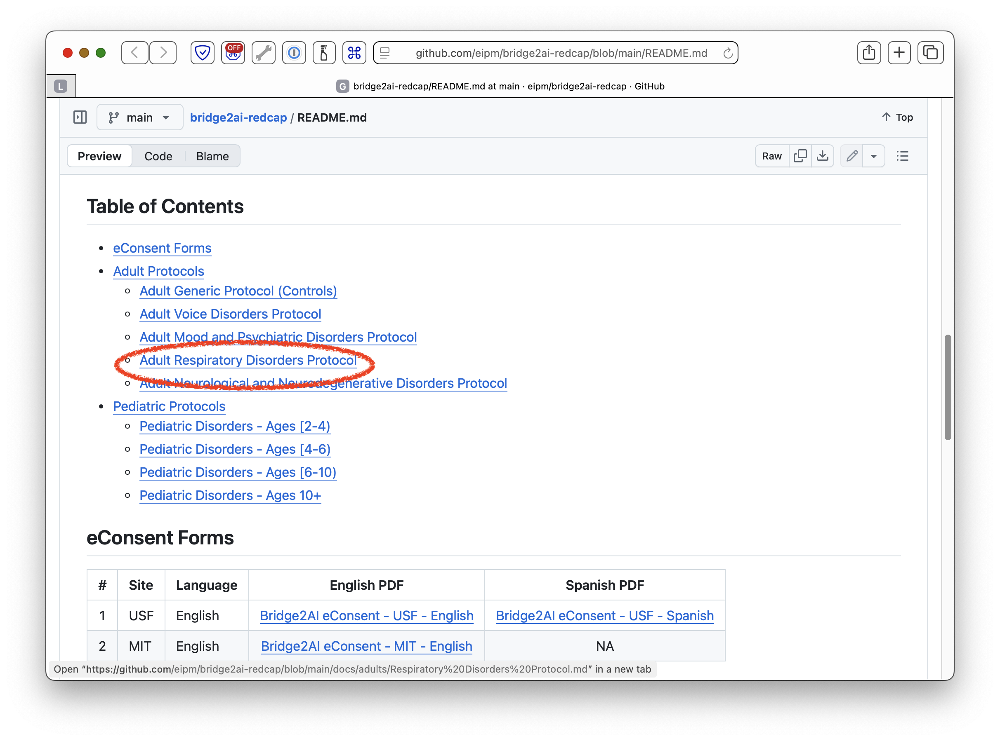
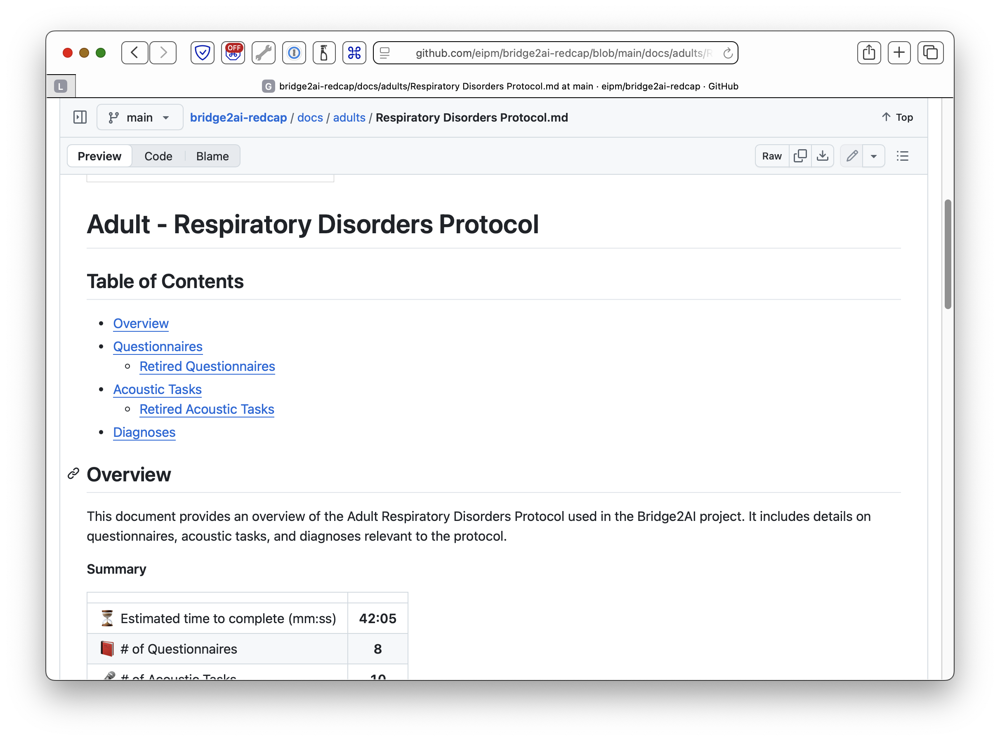
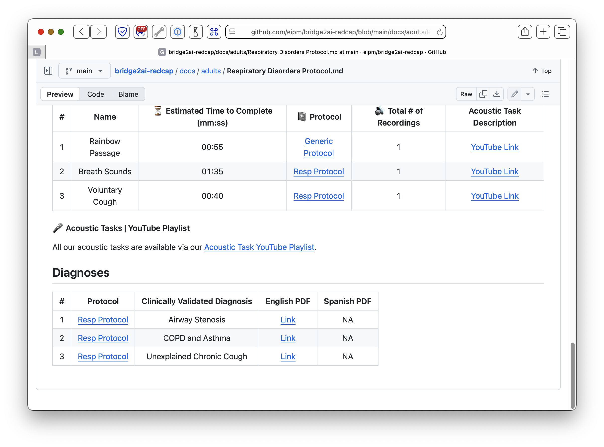
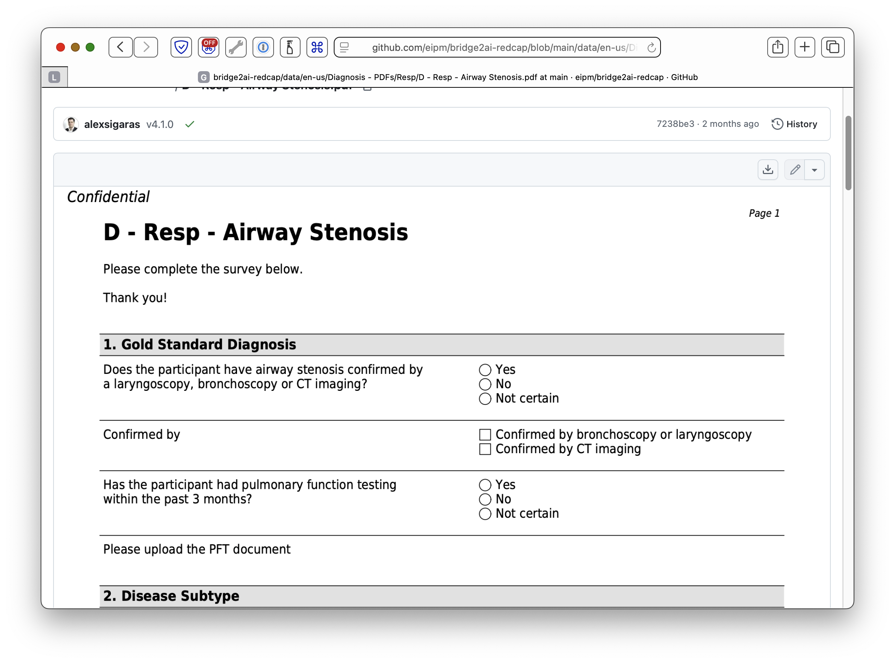
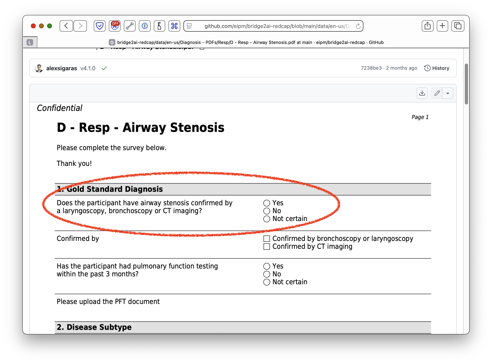
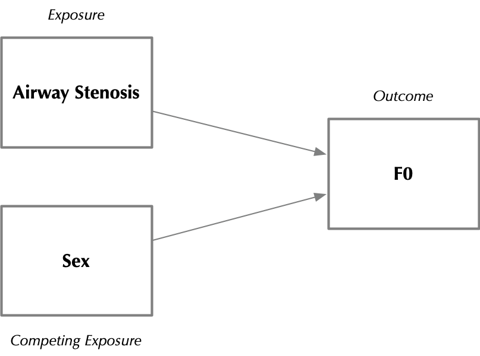
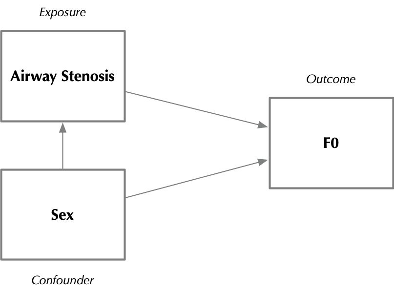

```{r setup, include=FALSE}
set.seed(42)
knitr::opts_chunk$set(dev = "ragg_png") # avoids relying on macOS's quartz/WindowServer backend
library(tidyverse)
library(gt)
library(gtsummary)
library(recipes)

source("ingest.R")
PATH_TO_PHYSIONET_DOWNLOAD_DIR <- "/Users/bedricks/Documents/b2ai_4.0/adult/"
PHENOTYPES_DIR <- fs::path_join(c(PATH_TO_PHYSIONET_DOWNLOAD_DIR, "phenotype"))
FEATURES_DIR <- fs::path_join(c(PATH_TO_PHYSIONET_DOWNLOAD_DIR, "features"))

full.data.dictionary <- read_csv("bridge2ai_voice_redcap_project_data_dictionary.csv")

```

## Plan for Today

1. Loading the dataset
2. Navigating around
3. Identifying a cohort
4. Assembling features
5. A simple analysis
6. Your turn!

## Loading the dataset {.smaller}

::: {.fragment .incremental}

Two primary sets of files:

- `phenotype/`
  - Participant-level information, including all RedCap-stored responses from questionnaire and acoustic tasks
  - Separate TSV files for individual tasks, enrollment forms, etc.
- `features/`: 
  - Audio features _computed_ from recordings of acoustic tasks
  - `static_features.tsv`:
    - F0, loudness, etc.
  - Other files (Parquet)
    - MFCC Spectrograms
    - Frame-level data (e.g. pitch contours) for tasks

:::

## Ingestion {.smaller}


## Ingestion {.smaller}

Begin by reading in the demographics files...

```{r load-demographics, eval=TRUE,echo=TRUE,message=FALSE,warning=FALSE}
demographics <- read_tsv(
  fs::path_join(c(
    PHENOTYPES_DIR, "demographics", "demographics.tsv")), col_types=cols(participant_id=col_character())) %>% 
  clean_age_col() # handle age binning
```


::: {.fragment}

What did we get?

:::

::: {.fragment}

```{r demographics-nrow, echo=TRUE}
demographics |> nrow()
```
::: 

::: {.fragment}

```{r demographics-ncol, echo=TRUE}
demographics |> ncol()
```

52 columns!

:::

::: {.fragment}

What are in those columns?

:::

::: {.fragment}

```{r demographics-colnames-display, echo=TRUE, eval=FALSE}
demographics |> colnames() |> sample(size=10)
```

::: 

::: {.fragment}
```{r demographics-colnames-sample}
demographics |> colnames() |> sample(size=10)
```
:::


## Orientation {.smaller}

::: {.fragment}
"How do I know what the columns mean?"
:::

::: {.fragment}
The columns in the phenotype TSV files correspond to entries in the RedCap-derived data dictionary!
:::

::: {.fragment}
1. File-level data dictionaries (`demographics.json`)
2. Omnibus [CSV data dictionary](https://github.com/eipm/bridge2ai-redcap/blob/main/data/bridge2ai_voice_project_data_dictionary.csv)
:::

::: {.fragment}
Hint: Look for fields whose `Form Name` is `q_generic_demographics` 
:::

::: {.fragment}

```{r data-dictionary-sample}
full.data.dictionary %>% filter(`Form Name`=='q_generic_demographics') %>% 
  select(`Variable / Field Name`, `Field Label`) %>% 
  sample_n(10) %>% gt

```
:::

## Orientation {.smaller}



## Orientation {.smaller}

```json
{
  "participant_id": {
    "description": "A unique identifier for the participant.",
    "valueType": [
      "xsd:string"
    ]
  },
  "children": {
    "description": "Indicates whether the participant has one or more children (response: yes/no).",
    "question": {
      "en": "One or more children"
    },
    "datatype": [
      "xsd:integer"
    ],
    "choices": [
      {
        "name": {
          "en": "Yes"
        },
        "value": 1
      },
      {
        "name": {
          "en": "No"
        },
        "value": 0
      }
    ],
    "termURL": "https://raw.githubusercontent.com/sensein/b2ai-redcap2rs/e5f4bcda2c45450b70c87dd0637645427c5e841b/activities/q_generic_demographics/items/children",
    "valueType": [
      "xsd:integer"
    ]
  },
  ...
}
```


## Data Tidying {.smaller}

A few data tidying gotchas to consider:

::: {.fragment}

- The `age` column is _generally_ numeric, but a handful of participants are coded `90 and above`
- Boolean fields (e.g. `children`) are coded as character strings (`"True"`/`"False"`)
- Some Boolean-"ish" fields also have e.g. "Prefer Not to Answer" options

:::

::: {.fragment}
Bottom line: _always check the data dictionary_!
:::

::: {.fragment}

Other things to think about:

- Demographic fields - how are they coded?
- Protocol-specific tidying

:::

## Data Tidying: A Repeated-Measures Gotcha {.smaller}

::: {.fragment}
`demographics.tsv` isn't quite one row per participant...
:::

::: {.fragment}
```{r demographics-dup-count, echo=TRUE}
demographics %>% count(participant_id) %>% filter(n>1) %>% nrow()
```
:::

::: {.fragment}
Some participants completed the demographics questionnaire more than once (see `demographics_session_id`) — e.g. at a follow-up visit.
:::

## Data Tidying: A Repeated-Measures Gotcha {.smaller}

::: {.fragment}
Usually harmless... but not always:

```{r demographics-dup-conflicts, echo=TRUE}
demographics %>% 
  group_by(participant_id) %>% 
  summarize(n_sex=n_distinct(sex_at_birth), n_age=n_distinct(age)) %>% 
  filter(n_sex>1 | n_age>1) %>% nrow()
```
:::

::: {.fragment}
For a handful of participants, `sex_at_birth` actually _disagrees_ across sessions — this looks like a data entry bug, not a legitimate change over time!
:::

::: {.callout-warning .fragment}
Naively joining on `participant_id` alone can silently duplicate or scramble rows downstream!
:::

## Data Tidying: A Repeated-Measures Gotcha {.smaller}

::: {.fragment}
For today, we'll resolve this by keeping each participant's _most recent_ session:

```{r demographics-dedup-fix, echo=TRUE}
demographics <- demographics %>% 
  mutate(.session_rank = replace_na(as.numeric(demographics_session_id), 0)) %>% 
  arrange(participant_id, .session_rank) %>% 
  group_by(participant_id) %>% 
  slice_tail(n = 1) %>% 
  ungroup() %>% 
  select(-.session_rank)
```
:::

::: {.fragment}
This is a judgment call — in a real analysis, you'd want to dig into _why_ these conflicts exist!
:::

## Meet Our Participants {.smaller}

```{r meet-participants-summary, echo=TRUE, message=FALSE, warning=FALSE}
demographics %>% 
  select(participant_id, sex_at_birth, age) %>% 
  distinct() %>% # one row per session, repeated per participant
  clean_age_col() %>% # handle 90+ binning
  mutate(sex_at_birth=replace_na(sex_at_birth, "Unknown")) %>% 
  tbl_summary(by=sex_at_birth, include=c(age))

```

## What's in our Toolbox?

::: {.fragment}

- `phenotype/confounders/confounders.tsv`
  - Confounders such as smoking history, certain medications, etc.
- `phenotype/diagnosis/*`
  - Relevant information about specific diagnoses
- `phenotype/questionnaire/*`
  - Responses to questionnaires (GAD-7, Leicester Cough Questionnaire, etc.)
- `phenotype/task/*`
  - Task-specific metadata
:::


# Identifying a Cohort


## Our goal: {.smaller}


### RQ: How do _jitter_ and _shimmer_ differ in patients with airway stenosis, as compared to controls?


::: {.fragment}

Comparison of interest: Airway stenosis vs. control population

:::

::: {.fragment}

Features of interest: _jitter_ / _shimmer_ , on some TBD acoustic task

:::

## Step 1: Who's in, who's out? {.smaller}

::: {.fragment}

There are two ways to identify clinical populations:

:::

::: {.fragment}

1. _Self-reported_ diagnostic status
2. _Clinically-validated_ diagnostic status

:::

::: {.fragment}

Starting with _self-reported status...

:::

## Step 1: Who's in, who's out? {.smaller}

::: {.fragment}

Self-reported conditions live in `phenotype/enrollment/eligibility.tsv`:

```{r load-eligibility, echo=TRUE, message=FALSE}
eligibility.table <- read_tsv(fs::path_join(c(
    PHENOTYPES_DIR, "enrollment", "eligibility.tsv")))
```
:::

::: {.fragment}

This table contains two types of information:

:::

::: {.fragment}

1. _Self-reported_ information from participants about various disorders
2. Information about the participant's status as a "control"

:::

::: {.fragment}

Columns starting with `self_reported_*` indicate participant-level status:

```{r self-reported-tally}
eligibility.table %>% select(participant_id, self_reported_airway_stenosis) %>% 
  group_by(self_reported_airway_stenosis) %>% tally()
```

:::

::: {.fragment}

Watch out for `NA`s!

:::

## Step 1: Who's in, who's out? {.smaller}

::: {.fragment}

Clinically-validated diagnoses live in _diagnosis-specific_ tables, in `phenotype/diagnosis`

:::


::: {.fragment}

Each diagnosis table contains detailed and specific participant-level metadata...

:::

::: {.fragment}

For example, participants with airway stenosis can be found in `phenotype/diagnosis/airway_stenosis.tsv`

:::


::: {.fragment}

We'll be talking more about diagnosis-specific tables in a minute...

:::

::: {.fragment}

But first, let's talk about **controls**... 

:::


## Cases vs. Controls  {.smaller}


::: {.fragment}
One way to find controls: use the `is_control_participant` column:

```{r is-control-tally, echo=TRUE}
eligibility.table %>% count(is_control_participant)
```

:::

## Cases vs. Controls  {.smaller}


::: {.fragment}

::: {.callout-caution}
The notion of "control" is tricky with voice...
:::

:::

::: {.fragment}
- Somebody who doesn't have condition _X_?
- Somebody with _no_ respiratory disorders at all?
- Somebody with _no_ factors affecting their voice?
- What does "normal" even mean?
:::

## Cases vs. Controls  {.smaller}

::: {.fragment}
Even among `is_control_participant` participants, there is heterogeneity:
:::

::: {.fragment}
```{r control-heterogeneity-table, echo=FALSE}
eligibility.table %>% filter(is_control_participant=="Yes") %>% pivot_longer(starts_with("self_reported"), names_to="condition", values_to="response") %>% 
  group_by(condition, response) %>% tally() %>% pivot_wider(names_from=response, values_from=n) %>% ungroup %>% gt
```

:::

::: {.fragment}
Moving on...
:::

## Cases vs. Controls  {.smaller}

::: {.callout-warning .fragment}
Our `is_control_participant=='Yes'` pool is agnostic to study site, diagnostic group, etc.
:::

::: {.fragment}
If cases and controls were recruited under different circumstances (sites, equipment, populations)... that's a potential confounder!
:::

::: {.fragment}
`phenotype/enrollment/participant.tsv` has a `site` column that (in a real analysis) we might use to diagnose this...
:::

## Cases vs. Controls  {.smaller}

Diagnoses each have separate TSVs...

::: {.fragment}
But how do we know which one we want?
:::

## Cases vs. Controls  {.smaller}

::: {.fragment}

:::

## Cases vs. Controls  {.smaller}


## Cases vs. Controls  {.smaller}



## Cases vs. Controls  {.smaller}



## Cases vs. Controls  {.smaller}



## Cases vs. Controls  {.smaller}


## Cases vs. Controls  {.smaller}




## Cases vs. Controls  {.smaller}

::: {.fragment}
```{r load-airway-stenosis-dx, echo=TRUE, message=FALSE}
airway.stenosis.dx <- read_tsv(
  fs::path_join(c(PHENOTYPES_DIR, "diagnosis", "airway_stenosis.tsv"))
)
```

:::

::: {.fragment}
```{r glimpse-airway-stenosis-dx, echo=TRUE}
glimpse(airway.stenosis.dx)
```

:::

## Cases vs. Controls  {.smaller}

Which variable?

::: {.fragment}



:::

## Cases vs. Controls  {.smaller}

Now, see if we can find that field in `airway_stenosis.json`:

```json
...
  "diagnosis_as_gold_standard_diagnosis": {
    "description": "Indicates whether the participant has airway stenosis confirmed by laryngoscopy, bronchoscopy, or CT imaging (Yes/No).",
    "question": {
      "en": "Does the participant have airway stenosis confirmed by a laryngoscopy, bronchoscopy or CT imaging?"
    },
...
```

## Cases vs. Controls  {.smaller}

Steps to build our cohort:

1. Cases: Participants in `tsv`, filter `diagnosis_as_gold_standard_diagnosis=='Yes'`
2. Controls: `eligibility.table` with `is_control_partipant=='Yes'`
3. Pick relevant columns (or make new ones!)
4. Combine

## Cases vs. Controls  {.smaller}

::: {.fragment}

Step 1: Find cases

::: 

::: {.fragment}
```{r cohort-find-cases, echo=TRUE}
airway.stenosis.cases <- airway.stenosis.dx %>% 
  filter(diagnosis_as_gold_standard_diagnosis=='Yes')
```

:::

::: {.fragment}
Step 2: Identify controls
:::

::: {.fragment}
```{r cohort-find-controls, echo=TRUE}
airway.stenosis.controls <- eligibility.table %>% 
  filter(is_control_participant=='Yes') %>% 
  filter(self_reported_airway_stenosis=="Unchecked") # belt-and-suspenders
```
:::

::: {.fragment}
Step 3: Do some tidying
:::

::: {.fragment}
```{r cohort-tidy-case-control, echo=TRUE}
airway.stenosis.cases <- airway.stenosis.cases %>% 
  select(participant_id) %>% 
  mutate(status='case')
airway.stenosis.controls <- airway.stenosis.controls %>%
  select(participant_id) %>% 
  mutate(status='control')
```

:::

## Cases vs. Controls  {.smaller}

::: {.fragment}
Step 4: Combine!
```{r cohort-combine, echo=TRUE}
airway.stenosis.cohort <- airway.stenosis.cases %>% rbind(airway.stenosis.controls)
```
:::

::: {.fragment}
Always do a sanity check:
:::

::: {.fragment}
```{r cohort-sanity-check, echo=TRUE}
airway.stenosis.cohort %>% count(status)
```
::: 

::: {.fragment}
Now we've got a cohort!
:::

## Warning: This is oversimplified

In a real analysis, your definition of "control" would need to be more clinically-grounded...

## Step 5: More Sanity Checking {.smaller}

Let's do some quick EDA with our new cohort:

:::: {.columns}

::: {.column width="50%" .fragment}

```{r eda-join-demographics}
stenosis.for.eda <- airway.stenosis.cohort |> 
  inner_join(demographics, by='participant_id') |> 
  select(participant_id, status, age, sex_at_birth) |> distinct()
```
```{r eda-summary-table, message=FALSE, warning=FALSE}
stenosis.for.eda |> tbl_summary(by=status, include=c(age,sex_at_birth)) |> add_p()
```

:::

::: {.column width="50%" .fragment}

```{r eda-age-boxplot, warning=FALSE, message=FALSE}
stenosis.for.eda %>% ggplot(aes(x=status,y=age,fill=sex_at_birth))+ geom_boxplot() +
  geom_jitter(alpha=0.25,  position=position_jitterdodge(jitter.width=0.2)) +
  theme_minimal()
  
```

:::
::::

::: {.fragment}

What do we notice about our cohort?

:::

## Final Cleanup

For _this_ analysis, we will exclude participants where `sex_at_birth` is `Unknown`:

```{r final-cleanup-filter-unknown-sex}
airway.stenosis.cohort <- airway.stenosis.cohort %>% 
  inner_join(demographics, by='participant_id') |> 
  filter(sex_at_birth != "Unknown") %>% 
  select(participant_id, status, age, sex_at_birth) # let's keep a few demographics around
```


# Assembling Features

## What features do we have? {.smaller}
 
The `static_features` dataframe contains _acoustic features_ computed from the various stimuli/tasks...

::: {.incremental}

- Pitch-related (e.g. F0)
  - Mean, plus other related stats
- Spectral features (e.g. jitter, shimmer)
- Loudness
- MFCCs (mea/std. dev)
- ASR-generated transcription*
- Etc.

:::

## Returning to our RQ... {.smaller}

We now need to identify an acoustic task of interest, to use as a sample.

::: {.fragment}

Let's use the `static_features` dataframe to see what our options are:
```{r load-static-features, message=FALSE, warning=FALSE}
static_features.raw <- read_tsv(fs::path_join(c(FEATURES_DIR, "static_features.tsv")))
```


:::

::: {.fragment}

```{r task-distribution-display, echo=TRUE, eval=FALSE}
airway.stenosis.cohort |> 
   # multiple sessions per participant
  inner_join(static_features.raw, by='participant_id', relationship = "many-to-many") |>
  select(participant_id, status, task_name) |> 
  tbl_summary(by=status, include=c(status,task_name),sort=task_name~"frequency")
```

:::

## Returning to our RQ... {.smaller .scrollable}

```{r task-distribution-table}
airway.stenosis.cohort |> 
  inner_join(static_features.raw, by='participant_id', relationship = "many-to-many") |>  # multiple sessions
  select(participant_id, status, task_name) |> 
  tbl_summary(by=status, include=c(status,task_name), sort=task_name~"frequency")
```

::: {.callout-note}

Note how we are not adjusting for multiple sessions!

:::

## Which features? {.smaller}


::: {.fragment}

Let's pick the "Prolonged Vowel" acoustic task.

:::

::: {.fragment}

> Hold a vowel sound (ɑ, as in "hot") for eight seconds...

:::

# Putting it All Together

## Assembling our Feature Matrix {.smaller}

A simple `inner_join`/`filter` will do the trick:

::: {.fragment}
```{r assemble-feature-matrix, echo=TRUE, warning=FALSE}
stenosis.cohort.features <- airway.stenosis.cohort |> 
  inner_join(static_features.raw, by='participant_id') |>
  filter(task_name=="prolonged-vowel")
```
:::

::: {.fragment}
```{r feature-matrix-colnames}
stenosis.cohort.features %>% colnames()
```
:::

## Sanity-checking and EDA {.smaller}

Let's take a look at our jitter/shimmer features: `local_jitter` and `local_shimmer`:


```{r jitter-shimmer-summary-table}

stenosis.cohort.features %>% 
  select(participant_id, age, sex_at_birth, status, local_jitter, local_shimmer) %>% 
  tbl_summary(by="status", include = c(local_jitter, local_shimmer)) %>% add_p

```

::: {.fragment}

This shows some face validity for using these features...

:::


## A Quick Aside About Confounding {.smaller}

The core premise of a voice biomarker looks something like this:a

:::: {.columns}


::: {.column width="50%"}

:::

::: {.column width="50%"}
:::

::::


## A Quick Aside About Confounding {.smaller}

However, there are lots of things that can affect voice acoustics:

:::: {.columns}

::: {.column width="50%"}


:::

::: {.column width="50%" .fragment}



:::

::::


## A Quick Aside About Confounding {.smaller}

Sometimes, these same factors _also_ affect our exposures!

:::: {.columns}

::: {.column width="50%" .incremental}


:::

::: {.column width="50%"}



:::

::::

::: {.fragment}

This is a classic example of confounding!

:::


::: {.callout-warning .fragment}

This is a very common source of problems with voice biomarkers!

:::

## Sanity-checking and EDA {.smaller}

Let's see if we have this problem in _our_ cohort!

::: {.fragment}
Let's look at our jitter and shimmer features...
:::


:::: {.columns}

::: {.column width="50%" .fragment}

```{r confounding-jitter-boxplot}
# jitterLocal_sma3nz_amean, localDB_shimmer
stenosis.cohort.features %>% 
  select(participant_id, status, sex_at_birth, local_jitter, local_shimmer) %>% 
  ggplot(aes(x=status, y=local_jitter, fill=sex_at_birth)) + geom_boxplot() +
  geom_jitter(position=position_jitterdodge(jitter.width=0.2), alpha=0.25) +
  theme_minimal() +
  labs(title = "Jitter")
  
```
:::

::: {.column width="50%" .fragment}

```{r confounding-shimmer-boxplot}
stenosis.cohort.features %>% 
  select(participant_id, status, sex_at_birth, local_jitter, local_shimmer) %>% 
  ggplot(aes(x=status, y=local_shimmer, fill=sex_at_birth)) + geom_boxplot() +
  geom_jitter(position=position_jitterdodge(jitter.width=0.2), alpha=0.25) +
  theme_minimal() +
  labs(title="Shimmer")
```


:::

::::

::: {.fragment}

Looks like we'll definitely want to account for sex in our modeling!

:::

## Finally, Some ML! {.smaller}

We'll use the `recipe` package to...

::: {.fragment}

- Center & scale our numeric features
- Recode our nominal features into dummy variables

:::

::: {.fragment}

```{r ml-design-matrix-recipe}
stenosis.design.matrix <- stenosis.cohort.features %>% 
  select(participant_id, status, age, sex_at_birth, local_jitter, local_shimmer) %>% 
  filter(!is.na(sex_at_birth)) # Exclude cases with missing sex, since it's a confounder and there aren't that many...

preproc_recipe <- recipe(status ~ ., data = stenosis.design.matrix) %>% 
  update_role(participant_id, new_role = "id") %>% # keep participant_id around for grouping, but it's not a predictor!
  step_center(all_numeric_predictors()) %>% # normalize so mean is zero
  step_scale(all_numeric_predictors()) %>% # scale s.t. SD is 1
  step_dummy(all_nominal_predictors())   # nominalize sex_at_birth
stenosis.design.matrix <- prep(preproc_recipe) %>% bake(stenosis.design.matrix)
```
```{r ml-design-matrix-display}
stenosis.design.matrix
```

:::

## Finally, Some ML! {.smaller}

Now, compute a test/train split:

::: {.fragment}

```{r ml-train-test-split, echo=TRUE}
library(rsample)
set.seed(42) # always set a seed!

# Some participants have multiple recording sessions for this task - a plain
# row-level split could put the same participant's sessions on both sides!
# group_initial_split() keeps every row for a given participant together.
stenosis.matrix.split <- group_initial_split(stenosis.design.matrix, group = participant_id, strata = status)
stenosis.matrix.split.train <- training(stenosis.matrix.split) %>% select(-participant_id)
stenosis.matrix.split.test <- testing(stenosis.matrix.split) %>% select(-participant_id)
```

:::

## Finally, Some ML! {.smaller}


::: {.fragment}

Now, we will fit a model to predict case/control status using jitter, shimmer, sex, and age.

:::

::: {.fragment}

Always check to see what your random-chance MLE estimate ought to be, as a baseline:

```{r ml-baseline-proportions, echo=TRUE}
stenosis.matrix.split.train |> 
  group_by(status) |> tally() |> 
  mutate(prop=n/sum(n))
```

:::

## Finally, Some ML! {.smaller}

Now, let's fit two models: GLM & Random Forest

### GLM

```{r ml-fit-glm, warning=FALSE, message=FALSE}
library(tidymodels)
library(parsnip)
library(workflows)
library(yardstick)

set.seed(42)

logit_model <- logistic_reg() |> set_engine("glm")
rf_model <- rand_forest(trees=75) |> set_engine("ranger") |> set_mode("classification")

glm_workflow <- workflow() %>% add_model(logit_model)
rf_workflow <- workflow() %>% add_model(rf_model)

# GLM

simple_glm <- glm_workflow %>% 
  add_formula(status ~ .) %>%  # predict `status` from all of the other variables
  fit(data=stenosis.matrix.split.train) # fit our GLM model

# Predict on our "test" partition
simple_glm_probs <- predict(simple_glm, stenosis.matrix.split.test, type="prob") %>% bind_cols(stenosis.matrix.split.test) # Predict, computing estimated class probabilities

simple_glm_clf <- predict(simple_glm, stenosis.matrix.split.test, type="class") %>% bind_cols(stenosis.matrix.split.test) # Predict, computing class labels

simple_glm_roc <- simple_glm_probs %>% roc_curve(status, .pred_case)

# Compute metrics
# simple_glm_probs %>% roc_auc(dx, .pred_airway_stenosis)
# simple_glm_clf %>% conf_mat(dx, .pred_class) %>% summary
# autoplot(simple_glm_roc)
# 
# simple_glm %>% tbl_regression()


```

:::: {.columns}

::: {.column width="50%" .fragment}


```{r ml-glm-conf-mat-auc}
simple_glm_clf %>% conf_mat(status, .pred_class) %>% summary %>% 
  rbind(simple_glm_probs %>% roc_auc(status, .pred_case)) %>% 
  rbind(simple_glm_probs %>% pr_auc(status, .pred_case)) 
```


:::

::: {.column width="50%" .fragment}

```{r ml-glm-roc-plot}
autoplot(simple_glm_roc)
```


:::

::::

## Finally, Some ML! {.smaller}

::: {.fragment}
Does jitter/shimmer add anything _beyond_ age and sex?
:::

::: {.fragment}
```{r ml-confounders-only-fit, echo=TRUE}
confounders_only_glm <- glm_workflow %>% 
  add_formula(status ~ age + sex_at_birth_Male) %>% 
  fit(data = stenosis.matrix.split.train)

confounders_only_probs <- predict(confounders_only_glm, stenosis.matrix.split.test, type = "prob") %>% 
  bind_cols(stenosis.matrix.split.test)
```
:::

::: {.fragment}
```{r ml-confounders-vs-full-auc, echo=TRUE}
bind_rows(
  confounders_only_probs %>% roc_auc(status, .pred_case) %>% mutate(model = "Confounders only (age + sex)"),
  simple_glm_probs %>% roc_auc(status, .pred_case) %>% mutate(model = "Full model (+ jitter/shimmer)")
)
```
:::

## Finally, Some ML! {.smaller}

Now, let's fit two models: GLM & Random Forest

### Random Forest


```{r ml-fit-rf}
# RF

simple_rf <- rf_workflow %>% add_formula(status ~ .) %>% 
  fit(data=stenosis.matrix.split.train)
simple_rf_probs <- predict(simple_rf, stenosis.matrix.split.test, type="prob") %>% bind_cols(stenosis.matrix.split.test)
simple_rf_clf <- predict(simple_rf, stenosis.matrix.split.test, type="class") %>% bind_cols(stenosis.matrix.split.test)
simple_rf_roc <- simple_rf_probs %>% roc_curve(status, .pred_case)


# simple_rf_probs %>% roc_auc(dx, .pred_airway_stenosis)
# simple_rf_clf %>% conf_mat(dx, .pred_class) %>% summary
# autoplot(simple_rf_roc)


```


:::: {.columns}

::: {.column width="50%" .fragment}

```{r ml-rf-conf-mat-auc}
simple_rf_clf %>% conf_mat(status, .pred_class) %>% summary %>% 
  rbind(simple_rf_probs %>% roc_auc(status, .pred_case)) %>% 
rbind(simple_rf_probs %>% pr_auc(status, .pred_case)) 


```


:::

::: {.column width="50%" .fragment}

```{r ml-rf-roc-plot}
autoplot(simple_rf_roc)
```


:::

::::

# Your turn!

The code for this walkthrough [is on Github](https://github.com/stevenbedrick/b2ai_f2f_oct_2026/blob/main/walkthrough_v4.qmd) as a reference!


